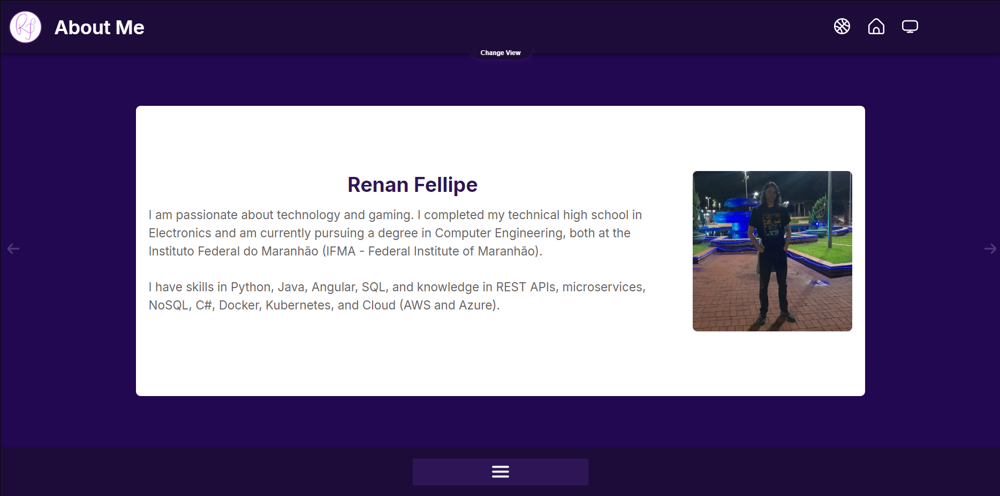
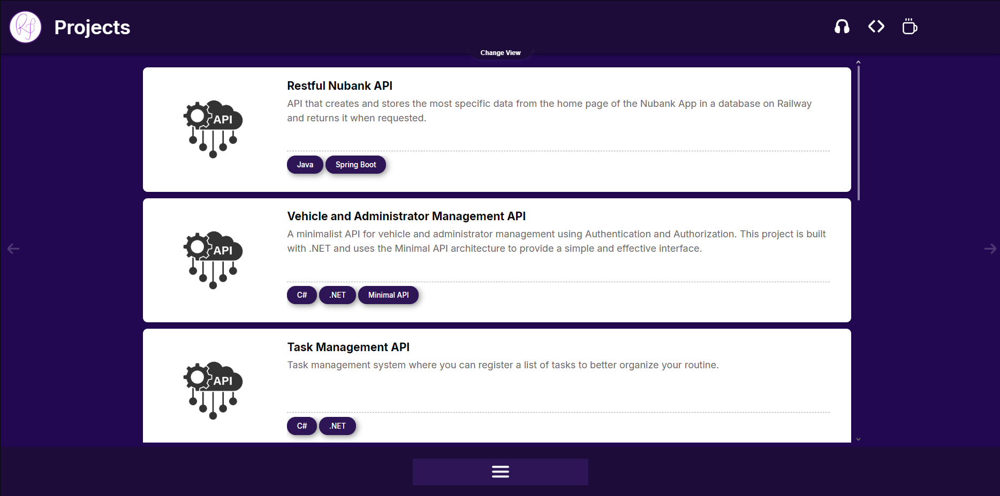
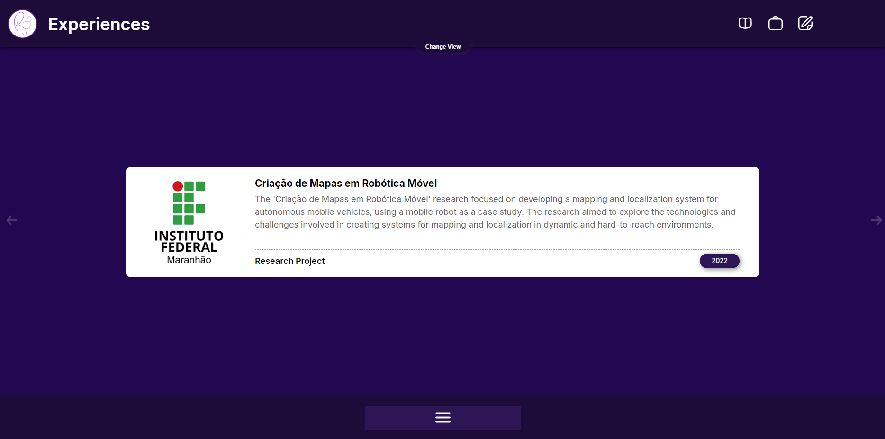
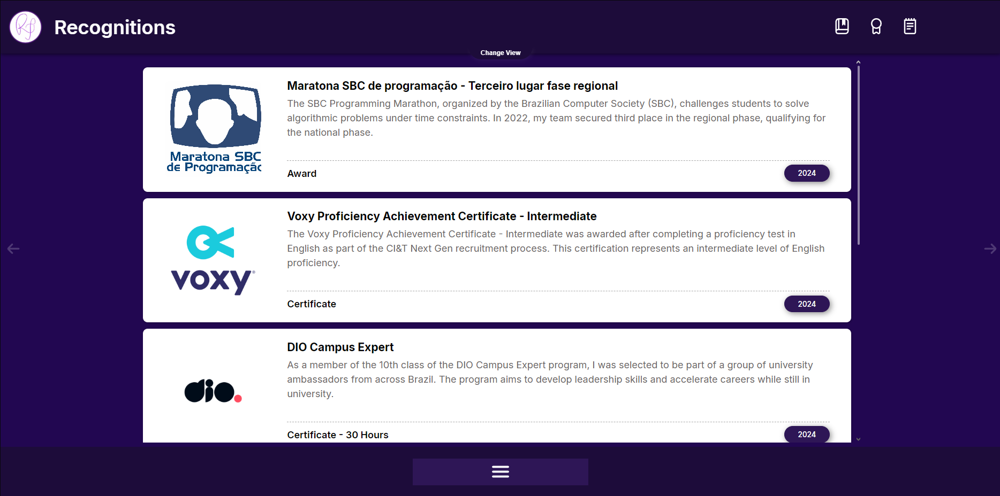
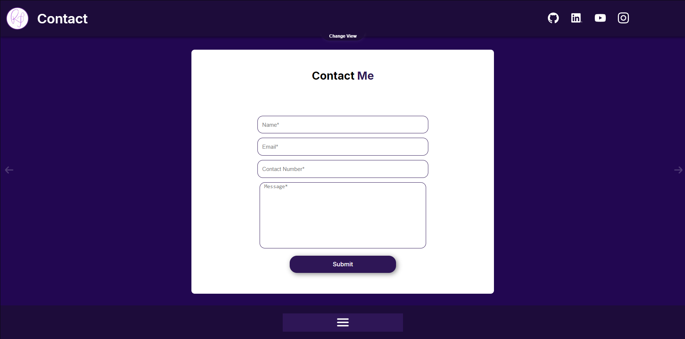
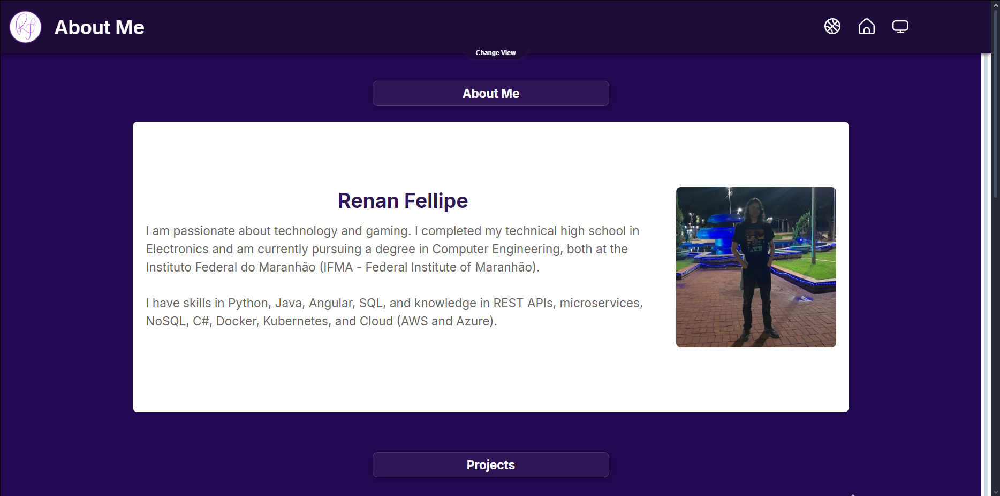
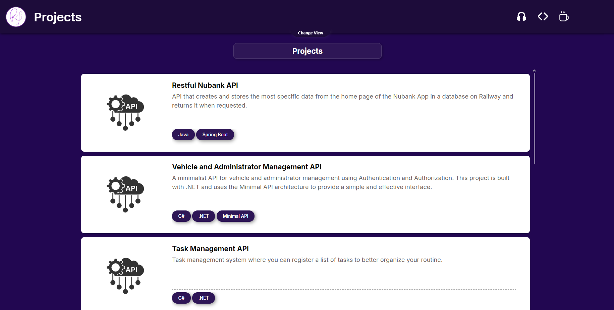
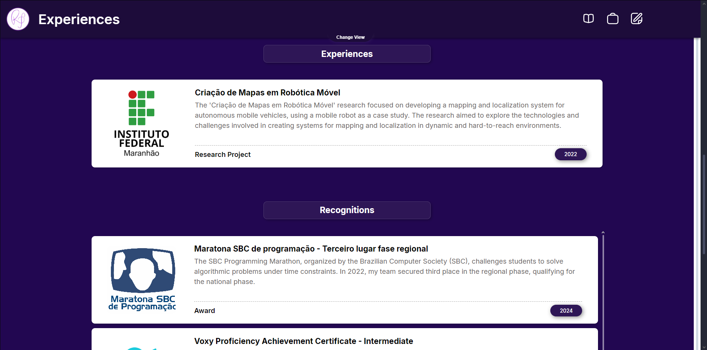
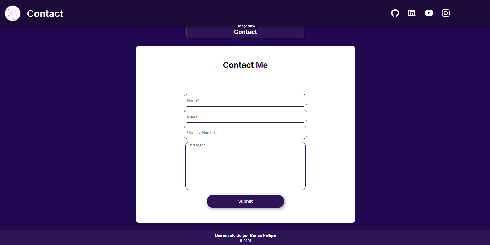

# 📌 Portfólio 

Welcome to my portfolio! Here, you'll find a collection of my projects, experiences, certifications, and achievements in the field of technology.

## 🧑‍💻 About Me

I'm Renan Fellipe, a Computer Engineering student at IFMA, passionate about technology and software development. I have experience in backend and full-stack development, with a focus on .NET, Java, Spring Boot, C#, and Angular, as well as knowledge in Cloud Computing, Microservices, REST APIs, Docker, Kubernetes, and SQL/NoSQL databases.

I'm part of Class 10 of the University Ambassadors Program at DIO, where I share knowledge and support the tech community. I also competed in the SBC Programming Marathon, placing 3rd in the regional phase and securing a spot in the national phase.

## 🏆 Achievements and Certifications

- 📜 Certifications in .NET, Spring Boot, Software Architecture, Cloud Computing, and Python through programs like Randstad, CI&T Next Gen, Microsoft Azure Essentials, Deal, Cognizant, and Claro.

- 💡 Research Project on Mapping and Localization for Mobile Robotics, using Python and Arduino.

- 📈 Participation in hackathons and technical challenges, always seeking innovation and scalable solutions.

## 🚀 Featured Projects
Here you’ll find some of my most relevant projects, including:

- ✔️ RESTful APIs for user, task, and vehicle management, developed with .NET (Minimal API) and Spring Boot.

- ✔️ Interactive Web Applications built with Angular and TypeScript.

- ✔️ Personal Projects like a BuzzFeed clone and a fanmade Pokémon game.

## 📬 Contact

Want to connect or collaborate on a project? Feel free to reach out!

📧 Email: 1renanfellipe5@gmail.com

🔗 LinkedIn: https://www.linkedin.com/in/renan-fellipe/

🐙 GitHub: https://github.com/Xounder

📺 YouTube: https://www.youtube.com/@Xounder_Tech

# Web Portfólio

The draft of this web portfolio, made in ***Figma***, can be found [here](https://www.figma.com/design/ftce0BXRJQSJXE3HjsqYGD/Portfolio?node-id=0-1&t=FJNZjil7Wk8QCEn7-1).

The ***Web Portfólio*** can be found [here](https://portfolio-renan-fellipes-projects.vercel.app)

## Home Page

## Scroll Page

## How to Run

Insert these comands in comand line

- `npm install` -> _Installs the project dependencies_

- `npm run dev` -> _Starts the React application in a development server_

## Delivery Pipeline (.opencode submodule)

This project is using the Delivery Pipeline harness through the `.opencode` Git submodule. It provides the development workflow, agents, skills, and documentation entry points.

For instructions on initializing the submodule, selecting this project's branch, configuring remote tracking, and pulling updates, see the [submodule setup guide](https://github.com/Xounder/delivery-pipeline/blob/master/.docs/07-submodule-install.md#cloning-a-codebase-that-contains-the-submodule). The guide also links to the required OpenCode plugin-dependency installation steps.
